# Wio Tracker L2 Pro UI 产品讨论稿

> 当前版本：0.5.1；更新日期：2026-11-12。
>
> 本文用于产品团队讨论页面内容、功能入口、操作流程和交互层级。页面描述以当前可见行为为基线；尚未统一的体验单独列为讨论项。
>
> 图片分为**实机截图**和**页面结构示意图**。示意图用于解释布局，不代表所有数据状态都已实测。

## 1. 产品范围

- 320×240横向触摸屏，中英文界面。
- 6个主页面：**首页 → 消息 → 联系人 → 地图 → 音频 → 设置**，循环切换。
- 共44个页面，覆盖首次使用引导、会话、联系人、地图、音频和设备工具。
- [全部页面图集](l2-ui-gallery.html)可在浏览器查看或打印。

## 2. 实机图与当前反馈

### 首页

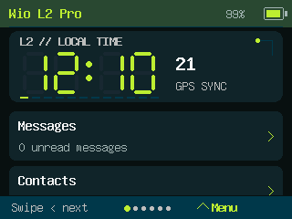

### 锁屏

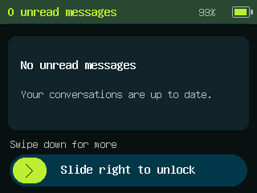

首页和锁屏为设备真实画面；其余页面配结构示意图。示意图中的时间、节点、消息、位置和文件名使用占位说明。

| 功能 | 当前反馈 |
| --- | --- |
| 左滑切下一页、首页大时钟与动效 | 用户确认正常 |
| 截屏开关、长按触发、成功提示与点击关闭 | 用户确认正常 |
| GPS定位、录音回放与音量 | 前一版本已确认，仍需随版本持续复测 |
| 全页面显示、多节点状态、地图文件、轨迹与航点、长时间使用 | 待专项验证 |

## 3. 全局交互与层级

### 3.1 布局与视觉

| 区域 | 产品要求 |
| --- | --- |
| 顶部状态栏 | 深绿色，左侧页面标题，右侧电量百分比和电池图标；需要确认通信设置时显示提示 |
| 主体内容 | 单列圆角卡片，内容较多时上下浏览；长内容不挤占固定操作区 |
| 底部提示 | 主页面显示当前页位置、左滑下一页和上滑菜单提示 |
| 底部导航 | 从屏幕底边上滑出现；颜色与正文和顶栏区分，体积紧凑 |
| 返回键 | 子页面统一左上角，橙色、仅箭头图标，与其他操作颜色区分 |
| 字体 | 正文清楚易读，标题和按钮加粗；首页使用大号数码时钟 |
| 颜色 | 暗色背景、较亮卡片、黄绿色强调；红色提示管理操作或节点未近期可见 |
| 动效 | 首页闪动冒号和扫描灯条；操作不出现整屏闪黑 |
| 电量 | 显示百分比与电池；未知显示占位，低电量突出提示。当前为估算，后续可调整曲线 |

### 3.2 操作规则

| 操作 | 结果 |
| --- | --- |
| 主页面左滑 | 下一页，末页回首页 |
| 主页面右滑 | 上一页，首页回末页 |
| 子页面左右滑 | 不自动切到其他主页面 |
| 内容上下滑 | 浏览本页列表或正文，滑动不误触按钮 |
| 点击 | 选择卡片或执行按钮功能 |
| 底边上滑 | 打开主导航；引导、锁屏和二次确认时不可打开 |
| 导航下滑、点空白或选中项 | 收起导航，不触发下方内容 |
| 导航5秒无操作 | 自动收起；手指按住期间不隐藏 |
| 播放器滑杆 | 调整进度或音量，不触发切页 |
| 锁屏滑块向右 | 从左端拖到右端并松手解锁，返回锁定前页面 |
| 锁屏卡片区下滑 | 查看较旧未读；上滑查看较新未读，每屏两条 |
| 左上角长按约1.2秒 | 开启截屏后保存当前画面；移动取消，短按返回仍有效 |
| 30秒无操作 | 熄屏；首次触摸仅唤醒 |
| 60秒无操作 | 进入锁屏 |
| BOOT键 | 正常使用时短按打开或关闭导航，长按返回；休眠后可唤醒 |
| 侧边唤醒键 | 亮屏时锁屏熄屏；灭屏时点亮 |

### 3.3 覆盖与返回

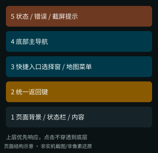

从下到上依次为：**页面内容 → 返回键 → 局部菜单/选择窗 → 底部主导航 → 状态或错误提示**。

- 浮窗打开后，点击窗外只关闭浮窗，不触发底层按钮。
- 底部导航出现时优先接收操作；状态、错误、截屏提示显示在导航之上。
- 二次确认和锁屏占满屏幕，暂时限制其他入口。
- 子页面一般返回进入前的页面；当前部分页面有固定返回目标，下文明确标注，需讨论是否统一。

### 3.4 核心流程

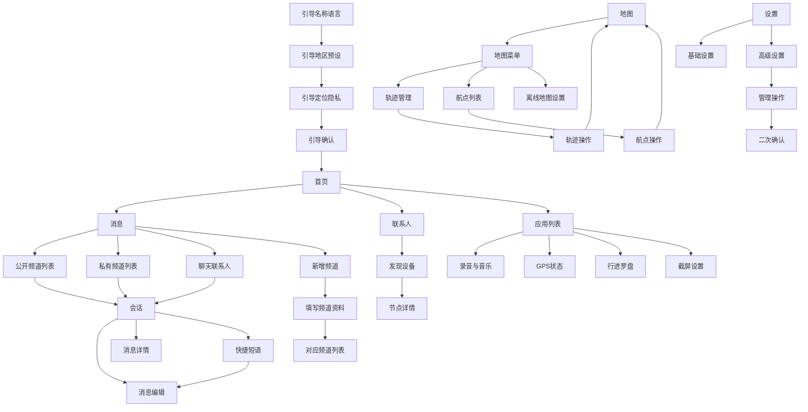

## 4. 页面目录

| 编号 | 页面 | 入口 |
| --- | --- | --- |
| 01 | [首页](#ui-00) | 引导完成；底部首页；主页面左右滑动 |
| 02 | [消息首页](#ui-01) | 首页 → Messages；底部消息；左右滑动 |
| 03 | [联系人主页](#ui-02) | 首页 → 联系人主页；底部联系人；左右滑动 |
| 04 | [地图主页](#ui-03) | 底部地图；左右滑动；GPS页；快捷入口；查看轨迹/航点 |
| 05 | [设置首页](#ui-04) | 底部设置；左右滑动 |
| 06 | [会话](#ui-05) | 频道列表；聊天联系人展开Message；已保存节点详情发消息 |
| 07 | [消息编辑](#ui-06) | 会话 → 写消息；短语选择后 |
| 08 | [节点详情](#ui-07) | 发现设备；其他非聊天列表入口 |
| 09 | [发现设备](#ui-08) | 联系人主页 → 发现 |
| 10 | [LoRa地区预设](#ui-09) | 基础设置 → LoRa；快捷入口；外部无线电参数变化 |
| 11 | [快捷操作](#ui-10) | 基础设置 → 显示与语言；应用列表；快捷入口 |
| 12 | [锁屏](#ui-11) | 快捷操作 → 锁屏；60s空闲；唤醒侧键 |
| 13 | [关于设备](#ui-12) | 基础设置；应用列表；快捷入口 |
| 14 | [引导1 名称语言](#ui-13) | 首次使用，或更新后需要重新确认设置时 |
| 15 | [引导2 地区预设](#ui-14) | 引导1 名称语言下一步 |
| 16 | [引导3 定位隐私](#ui-15) | 引导2 地区预设确认 |
| 17 | [引导4 确认开始](#ui-16) | 引导3 定位隐私 → 继续 |
| 18 | [通用输入](#ui-17) | 名称；手工联系人；新频道 |
| 19 | [表情选择](#ui-18) | 消息编辑 → 表情选择 |
| 20 | [二次确认](#ui-19) | 删除轨迹/航点、关闭BLE、管理、Sleep |
| 21 | [消息详情](#ui-20) | 会话消息卡 |
| 22 | [快捷短语](#ui-21) | 会话 → 快捷回复；消息编辑 → 短语 |
| 23 | [硬件状态](#ui-22) | 高级设置；应用列表/首页快捷入口 |
| 24 | [触控测试](#ui-23) | 硬件状态 → 触控测试 |
| 25 | [音频主页](#ui-24) | 底部音频主页；左右滑动；应用列表/快捷入口 |
| 26 | [公开频道列表](#ui-25) | 消息首页 → 公开频道 |
| 27 | [私有频道列表](#ui-26) | 消息首页 → 私有频道 |
| 28 | [消息中的联系人](#ui-27) | 消息首页 → 联系人主页 |
| 29 | [基础设置](#ui-28) | 设置首页 → 基础设置 |
| 30 | [高级设置](#ui-29) | 设置首页 → 高级设置 |
| 31 | [录音列表/录制](#ui-30) | 音频主页 → 录音 |
| 32 | [音乐文件列表](#ui-31) | 音频主页 → 音乐文件列表；快捷入口 |
| 33 | [新增频道类型](#ui-32) | 消息首页 新增；列表+；快捷入口 |
| 34 | [正在播放](#ui-33) | 音乐文件列表/录音列表/录制点击文件；音频主页 → 正在播放 |
| 35 | [轨迹管理](#ui-34) | 地图菜单轨迹；应用列表；快捷入口 |
| 36 | [轨迹操作](#ui-35) | 轨迹管理点击轨迹 |
| 37 | [航点列表](#ui-36) | 地图航点；应用列表；快捷入口 |
| 38 | [航点操作](#ui-37) | 航点列表点击航点 |
| 39 | [离线瓦片](#ui-38) | 地图离线地图；应用列表 → 离线瓦片 |
| 40 | [GPS状态](#ui-39) | 应用列表；高级设置 GPS；地图条；罗盘；无定位结果航点入口 |
| 41 | [应用列表](#ui-40) | 首页 → 应用列表 |
| 42 | [管理操作](#ui-41) | 高级设置 → 红色管理操作 |
| 43 | [GPS行进罗盘](#ui-42) | 应用列表 → GPS行进罗盘 |
| 44 | [截屏设置](#ui-43) | 应用列表 → 截屏 |

## 5. 逐页内容与操作

逐页按 **页面组件、占比、色彩、交互方式、功能** 五列描述。**占比按整屏高度20等份给出产品讨论建议，不是当前界面的实测值**；每页独占区域合计20/20，悬浮组件单独标为叠加，不重复计入。色彩参考现有界面，均可在产品讨论中调整。

示意图用于理解当前布局，未按建议占比重新设计；表格中的占比、图片与最终视觉稿需在定稿时统一。所有页面仍遵循通用交互规则。

### 01 首页

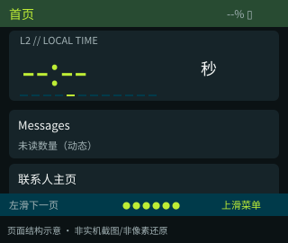

**入口：** 引导完成；底部首页；主页面左右滑动。

**使用场景：** 查看时间和未读概况，进入常用功能。

| 页面组件 | 占比 | 色彩 | 交互方式 | 功能 |
| --- | --- | --- | --- | --- |
| 状态栏 | 2/20 | 深绿底；黄绿标题；浅灰状态 | 显示 | 显示页面标题、电量百分比和电池图标。 |
| 大号时钟区 | 7/20 | 深色卡片；黄绿色数字；浅灰秒数 | 查看；轻量动效 | 显示时分、秒数和校时状态；冒号闪动、灯条扫描；未校时时显示横线。 |
| 常用功能与快捷入口 | 8/20 | 深色卡片；浅色文字；黄绿色重点 | 上下滑动；点击 | 单栏浏览消息、联系人、应用和自定义入口，列表末尾保留新增按钮。 • **消息**：消息首页；未读总数 • **联系人**：联系人主页；节点数量 • **应用**：应用列表 • **自定义快捷入口**：对应目标，见候选表 • **底部 +**：打开快捷入口选择窗 |
| 底部菜单提示区 | 3/20 | 深青底；浅灰提示；黄绿色标记 | 左右滑动；底边上滑 | 显示所在页面和手势提示；左滑下一页，右滑上一页；底边上滑打开六项主导航。 |

**返回：** 主页面，无返回箭头。

**补充规则：** 未校时时显示横线；完成校时后显示时间与秒数。冒号闪动、灯条扫描；上下浏览可找到应用入口和新增快捷入口按钮。

### 02 消息首页

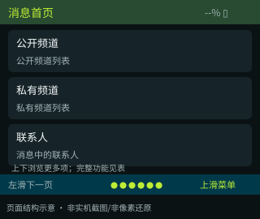

**入口：** 首页 → Messages；底部消息；左右滑动。

**使用场景：** 先选择公开、私有或联系人会话，再浏览消息。

| 页面组件 | 占比 | 色彩 | 交互方式 | 功能 |
| --- | --- | --- | --- | --- |
| 状态栏 | 2/20 | 深绿底；黄绿标题；浅灰状态 | 显示；点击 | 显示页面标题、电量百分比和电池图标。 • **顶部新增**：新增频道类型 |
| 公开频道入口 | 5/20 | 深色卡片；浅色文字；黄绿色重点 | 点击 | • **公开频道**：公开频道列表 |
| 私有频道入口 | 5/20 | 深色卡片；浅色文字；黄绿色重点 | 点击 | • **私有频道**：私有频道列表 |
| 联系人会话入口 | 5/20 | 深色卡片；浅色文字；黄绿色重点 | 点击 | • **联系人**：消息中的联系人 |
| 底部菜单提示区 | 3/20 | 深青底；浅灰提示；黄绿色标记 | 左右滑动；底边上滑 | 显示所在页面和手势提示；左滑下一页，右滑上一页；底边上滑打开六项主导航。 |

**返回：** 主页面，无返回箭头。

### 03 联系人主页

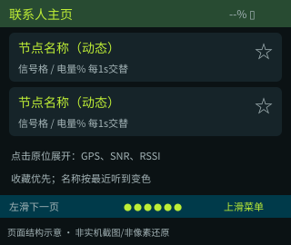

**入口：** 首页 → 联系人主页；底部联系人；左右滑动。

**使用场景：** 查找节点、查看状态、收藏常用联系人并发起私聊。

| 页面组件 | 占比 | 色彩 | 交互方式 | 功能 |
| --- | --- | --- | --- | --- |
| 状态栏 | 2/20 | 深绿底；黄绿标题；浅灰状态 | 显示；点击 | 显示页面标题、电量百分比和电池图标。 • **顶部发现**：发现设备 • **顶部新增**：通用输入：联系人公钥 → 联系人名称 |
| 联系人卡片 | 15/20 | 深色卡片；浅色文字；黄绿色重点 | 上下滑动；点击 | 名称固定显示；近期可见为绿色，否则红色。信号格与电量每1秒交替；点击卡片原位展开位置、SNR、RSSI；星标点亮后置顶。 • **节点卡**：原位展开或收起；同一时间只展开一个节点 • **星标**：收藏切换保存；列表回顶部 • **展开Message**：私聊会话（聊天类型节点） |
| 底部菜单提示区 | 3/20 | 深青底；浅灰提示；黄绿色标记 | 左右滑动；底边上滑 | 显示所在页面和手势提示；左滑下一页，右滑上一页；底边上滑打开六项主导航。 |

**返回：** 主页面，无返回箭头。

**补充规则：** 点击卡片后原位变宽并展开GPS、SNR、RSSI，再次点击收起。15分钟内收到过节点信息时名称为绿色，否则红色；这是近期可见状态。电量依赖对方上报，缺失或超过1小时显示未知。展开时可请求一次节点状态，不会每秒轮询对方。

### 04 地图主页

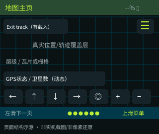

**入口：** 底部地图；左右滑动；GPS页；快捷入口；查看轨迹/航点。

**使用场景：** 查看位置、离线地图及载入的轨迹，调整地图视野。

| 页面组件 | 占比 | 色彩 | 交互方式 | 功能 |
| --- | --- | --- | --- | --- |
| 状态栏 | 2/20 | 深绿底；黄绿标题；浅灰状态 | 显示 | 显示页面标题、电量百分比和电池图标。 |
| 地图画布与定位信息 | 13/20 | 地图图片或暗色栅格；绿色当前位置；琥珀色旧位置 | 查看；点击定位状态 | 显示离线地图、当前位置或最后位置、缩放层级和卫星状态；没有位置时不显示虚假定位点。 • **定位状态条**：GPS状态 |
| 地图移动与缩放区 | 3/20 | 深色卡片；浅色文字；黄绿色重点 | 点击 | 保留四向移动、定位回中、放大、缩小按钮。 • **< / ^ / v / >**：视图左/上/下/右平移，每次64px • **O**：居中GPS恢复跟随（至少曾有真实位置） • **+ / -**：缩放一级，3～18 |
| 底部菜单提示区 | 2/20 | 深青底；浅灰提示；黄绿色标记 | 左右滑动；底边上滑 | 显示所在页面和手势提示；左滑下一页，右滑上一页；底边上滑打开六项主导航。 |
| 地图菜单与轨迹退出键 | 悬浮叠加 | 深色悬浮按钮；黄绿色图标 | 点击 | 悬浮在地图上方，不改变主布局；仅载入轨迹时显示退出按钮。 • **三横线**：打开或关闭地图菜单 • **退出轨迹显示**：退出覆盖层，不删除文件（有载入轨迹） |

**返回：** 主页面，无返回箭头。

**补充规则：** 当前位置绿实心，旧位置琥珀空心；无坐标不伪造点。SD /map/z/x/y.png，XYZ 256×256 PNG，缺图栅格。地图按方向键移动；左右滑仍切主页。

### 05 设置首页

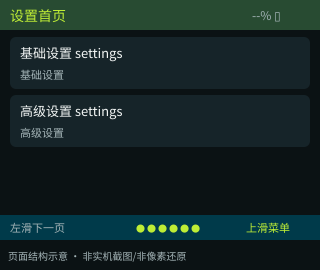

**入口：** 底部设置；左右滑动。

**使用场景：** 按使用经验选择基础或高级配置。

| 页面组件 | 占比 | 色彩 | 交互方式 | 功能 |
| --- | --- | --- | --- | --- |
| 状态栏 | 2/20 | 深绿底；黄绿标题；浅灰状态 | 显示 | 显示页面标题、电量百分比和电池图标。 |
| 内容列表 | 15/20 | 深色卡片；浅色文字；黄绿色重点 | 上下滑动；点击 | 基础设置/高级设置两个入口。 • **基础设置 settings**：基础设置 • **高级设置 settings**：高级设置 |
| 底部菜单提示区 | 3/20 | 深青底；浅灰提示；黄绿色标记 | 左右滑动；底边上滑 | 显示所在页面和手势提示；左滑下一页，右滑上一页；底边上滑打开六项主导航。 |

**返回：** 主页面，无返回箭头。

### 06 会话

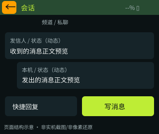

**入口：** 频道列表；聊天联系人展开Message；已保存节点详情发消息。

**使用场景：** 浏览同一频道或联系人的消息并准备回复。

| 页面组件 | 占比 | 色彩 | 交互方式 | 功能 |
| --- | --- | --- | --- | --- |
| 状态栏与返回键 | 2/20 | 深绿底；黄绿标题；浅灰状态；橙色返回键 | 显示；点击 | 显示页面标题、电量百分比和电池图标。 点击左上橙色箭头：进入会话前的列表，恢复位置。 |
| 会话类型区 | 2/20 | 暗色背景；浅色正文；灰色说明 | 查看 | 显示当前会话名称及频道或私聊类型。 |
| 消息记录区 | 12/20 | 深色卡片；浅色文字；黄绿色重点 | 上下滑动；点击 | 收到与发出的消息区分排列，显示发信人、状态和正文预览；上下滑动查看历史。 • **消息卡**：消息详情 |
| 回复操作区 | 4/20 | 深色卡片；浅色文字；黄绿色重点；写消息为黄绿色 | 点击 | • **快捷回复**：快捷短语；选择后去消息编辑 • **写消息**：消息编辑，加载目标草稿 |

**返回：** 进入会话前的列表，恢复位置。

**补充规则：** 进入会话会标记对应消息已读，并显示最新消息。所有会话合计保留最近48条历史；不同会话内容分开显示。

### 07 消息编辑

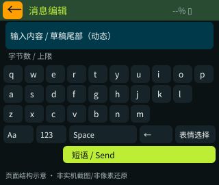

**入口：** 会话 → 写消息；短语选择后。

**使用场景：** 使用设备本机键盘编辑和发送消息。

| 页面组件 | 占比 | 色彩 | 交互方式 | 功能 |
| --- | --- | --- | --- | --- |
| 状态栏与返回键 | 2/20 | 深绿底；黄绿标题；浅灰状态；橙色返回键 | 显示；点击 | 显示页面标题、电量百分比和电池图标。 点击左上橙色箭头：保存草稿后回会话；失败留页。 |
| 输入内容区 | 4/20 | 暗底；青色边框；浅色文字 | 查看编辑结果 | 显示正在编辑的内容，较长时显示末尾，避免挤占键盘。 |
| 长度提示区 | 1/20 | 灰色说明；超限时强调提示 | 查看 | 显示输入长度与当前允许上限。 |
| 键盘与编辑工具 | 9/20 | 深色卡片；浅色文字；黄绿色重点 | 点击输入 | 字母、数字和符号键盘；大小写、空格、删除等工具。 • **字符键**：追加选中的字符 • **Aa**：大小写 • **123**：字母/符号 • **Space**：空格 • **<-**：删除完整文字字符 • **表情**：表情选择 |
| 完成操作区 | 4/20 | 黄绿色按钮；深色文字 | 点击 | • **短语**：快捷短语 • **发送**：成功清草稿回会话；失败保留（非空、未超字节限、允许发送消息） |

**返回：** 保存草稿后回会话；失败留页。

**补充规则：** 私聊正文最多160字节；频道消息需要预留发信人名称所占长度。界面可切换中英文，目前键盘不支持中文拼音。提交失败保留草稿，成功后返回会话。

### 08 节点详情

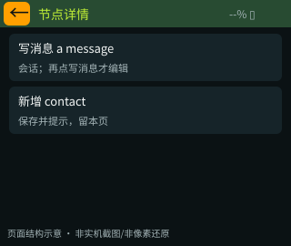

**入口：** 发现设备；其他非聊天列表入口。

**使用场景：** 查看节点身份，决定添加联系人或开始会话。

| 页面组件 | 占比 | 色彩 | 交互方式 | 功能 |
| --- | --- | --- | --- | --- |
| 状态栏与返回键 | 2/20 | 深绿底；黄绿标题；浅灰状态；橙色返回键 | 显示；点击 | 显示页面标题、电量百分比和电池图标。 点击左上橙色箭头：进入详情前的列表。 |
| 节点身份信息 | 13/20 | 暗色背景；浅色正文；灰色说明 | 查看 | 显示节点名称、公钥、是否已保存等信息。 |
| 联系人操作区 | 5/20 | 深色卡片；浅色文字；黄绿色重点 | 点击 | 按钮随联系人是否已保存而变化。 • **写消息 a message**：会话；再点写消息才编辑（已保存聊天节点） • **新增 contact**：保存并提示，留本页（未保存） |

**返回：** 进入详情前的列表。

**补充规则：** 联系人主页以卡片原位展开为主；本页用于发现设备后查看节点身份与添加联系人。

### 09 发现设备

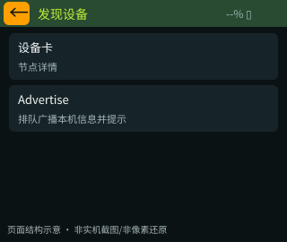

**入口：** 联系人主页 → 发现。

**使用场景：** 浏览近期收到广播的节点。

| 页面组件 | 占比 | 色彩 | 交互方式 | 功能 |
| --- | --- | --- | --- | --- |
| 状态栏与返回键 | 2/20 | 深绿底；黄绿标题；浅灰状态；橙色返回键 | 显示；点击 | 显示页面标题、电量百分比和电池图标。 点击左上橙色箭头：固定联系人主页。 • **Advertise**：排队广播本机信息并提示（允许发送消息） |
| 发现设备列表 | 18/20 | 深色卡片；浅色文字；黄绿色重点 | 上下滑动；点击 | 最多16条广播设备及收到后秒数；Advertise。 • **设备卡**：节点详情 |

**返回：** 固定联系人主页。

**补充规则：** 被动收集；打开页面不主动扫描；重复公钥更新。

### 10 LoRa地区预设

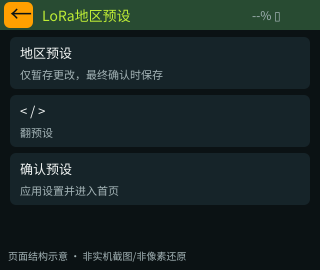

**入口：** 基础设置 → LoRa；快捷入口；外部无线电参数变化。

**使用场景：** 选择与使用地区和其他设备一致的通信预设。

| 页面组件 | 占比 | 色彩 | 交互方式 | 功能 |
| --- | --- | --- | --- | --- |
| 状态栏与返回键 | 2/20 | 深绿底；黄绿标题；浅灰状态；橙色返回键 | 显示；点击 | 显示页面标题、电量百分比和电池图标。 点击左上橙色箭头：进入本页前的页面，通常基础设置。 |
| 地区选择提示 | 3/20 | 暗色背景；浅色正文；灰色说明 | 查看 | 说明需要选择适用地区和通信预设。 |
| 地区预设列表 | 10/20 | 深色卡片；浅色文字；黄绿色重点 | 上下滑动；点击 | 上下浏览并点击选择预设，选中项突出显示。 • **地区预设**：仅暂存更改，最终确认时保存 |
| 选中预设说明 | 2/20 | 灰色说明；黄绿色重点 | 查看 | 显示所选预设的关键通信参数。 |
| 翻页与确认区 | 3/20 | 深色卡片；浅色文字；黄绿色重点；确认为黄绿色 | 点击 | • **< / >**：翻预设 • **确认预设**：应用设置并进入首页（已选择预设，设备当前可以应用设置） |

**返回：** 进入本页前的页面，通常基础设置。

**补充规则：** 选择预设后，点击确认才应用设置。当前按地区预设选择，不能自由编辑全部无线电参数；默认发送功率14dBm。

### 11 快捷操作

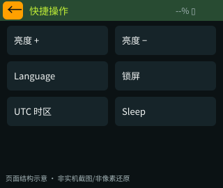

**入口：** 基础设置 → 显示与语言；应用列表；快捷入口。

**使用场景：** 快速调整显示、语言、时区，或锁屏休眠。

| 页面组件 | 占比 | 色彩 | 交互方式 | 功能 |
| --- | --- | --- | --- | --- |
| 状态栏与返回键 | 2/20 | 深绿底；黄绿标题；浅灰状态；橙色返回键 | 显示；点击 | 显示页面标题、电量百分比和电池图标。 点击左上橙色箭头：返回进入快捷操作前的页面；连续跨页使用后的返回体验仍需统一。 |
| 快捷操作按钮区 | 18/20 | 深色卡片；浅色文字；黄绿色重点 | 上下滑动；点击 | 亮度增加、亮度降低、语言切换、锁屏、时区与休眠六个按钮。 • **亮度增加/降低**：26/64/128/191/255背光档切换保存 • **语言切换**：English/简体中文切换保存 • **锁屏**：锁屏，记录锁定前的页面 • **UTC偏移**：每次+1h，+14后回-12 • **休眠**：二次确认 |

**返回：** 返回进入快捷操作前的页面；连续跨页使用后的返回体验仍需统一。

**补充规则：** 使用统一左上返回键退出。

### 12 锁屏

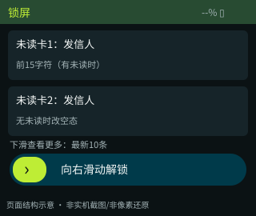

**入口：** 快捷操作 → 锁屏；60s空闲；唤醒侧键。

**使用场景：** 不解锁设备，也能简单浏览未读信息。

| 页面组件 | 占比 | 色彩 | 交互方式 | 功能 |
| --- | --- | --- | --- | --- |
| 状态栏 | 2/20 | 深绿底；黄绿标题；浅灰状态 | 显示 | 显示未读信息总数、电量百分比和电池图标。 |
| 未读信息卡片区 | 12/20 | 深色圆角卡片；黄绿发信人；浅色摘要 | 上下滑动 | 最多一次显示2条未读；上下滑动查看最新10条；每条包含发信人和摘要，当前摘要最多15个字符。 • **卡区上下滑**：每次2条；下滑看较旧 |
| 浏览与解锁提示 | 2/20 | 灰色说明文字 | 查看 | 提示下滑查看更多未读及向右滑动解锁。 |
| 解锁栏 | 4/20 | 深青轨道；黄绿色滑块；浅色提示 | 滑块向右拖动并松手 | 从轨道左端拖到右端后解锁；不再使用长按。 • **滑块右拖至末端松手**：恢复锁定前页面 |

**返回：** 无返回/主导航；解锁回锁定前的页面。

**补充规则：** 无未读空态；卡不点进会话。灭屏首次触摸只唤醒。不再长按解锁；可全局截屏。

### 13 关于设备

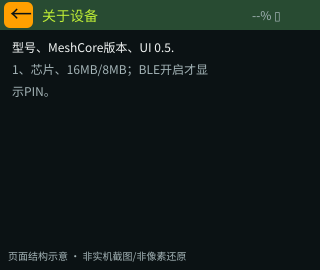

**入口：** 基础设置；应用列表；快捷入口。

**使用场景：** 查看设备与版本信息，查找蓝牙配对码。

| 页面组件 | 占比 | 色彩 | 交互方式 | 功能 |
| --- | --- | --- | --- | --- |
| 状态栏与返回键 | 2/20 | 深绿底；黄绿标题；浅灰状态；橙色返回键 | 显示；点击 | 显示页面标题、电量百分比和电池图标。 点击左上橙色箭头：返回基础设置。当前即使从应用列表进入，也返回基础设置；是否统一原路返回，列入讨论项。 |
| 设备信息区 | 18/20 | 暗色背景；浅色正文；灰色说明 | 查看 | 型号、MeshCore版本、UI 0.5.1、芯片、16MB/8MB；BLE开启才显示PIN。 |

**返回：** 返回基础设置。当前即使从应用列表进入，也返回基础设置；是否统一原路返回，列入讨论项。

**补充规则：** 蓝牙开启时显示配对码。

### 14 引导1 名称语言

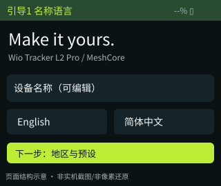

**入口：** 首次使用，或更新后需要重新确认设置时。

**使用场景：** 首次使用时选择语言并命名设备。

| 页面组件 | 占比 | 色彩 | 交互方式 | 功能 |
| --- | --- | --- | --- | --- |
| 状态栏 | 2/20 | 深绿底；黄绿标题；浅灰状态 | 显示 | 显示页面标题、电量百分比和电池图标。 |
| 欢迎说明区 | 6/20 | 暗色背景；浅色正文；灰色说明 | 查看 | 介绍设备并提示开始设置。 |
| 设备名称区 | 5/20 | 深色卡片；浅色文字；黄绿色重点 | 点击 | • **设备名**：通用输入 设备名称，完成回本页 |
| 语言选择区 | 3/20 | 深色卡片；浅色文字；黄绿色重点；已选项黄绿色 | 点击 | • **English / 简体中文**：暂存设置语言 |
| 下一步 | 4/20 | 黄绿色按钮；深色文字 | 点击 | • **下一步**：引导2 地区预设 |

**返回：** 引导首屏无返回。

**补充规则：** 完成引导前不发送消息。重新进入引导不清空原有联系人、消息或SD文件。

### 15 引导2 地区预设

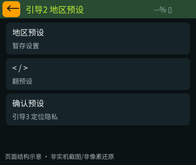

**入口：** 引导1 名称语言下一步。

**使用场景：** 首次使用时选择通信地区与预设。

| 页面组件 | 占比 | 色彩 | 交互方式 | 功能 |
| --- | --- | --- | --- | --- |
| 状态栏与返回键 | 2/20 | 深绿底；黄绿标题；浅灰状态；橙色返回键 | 显示；点击 | 显示页面标题、电量百分比和电池图标。 点击左上橙色箭头：引导1 名称语言。 |
| 地区选择提示 | 3/20 | 暗色背景；浅色正文；灰色说明 | 查看 | 说明需要选择适用地区和通信预设。 |
| 地区预设列表 | 10/20 | 深色卡片；浅色文字；黄绿色重点 | 上下滑动；点击 | 上下浏览并点击选择预设，选中项突出显示。 • **地区预设**：暂存设置 |
| 选中预设说明 | 2/20 | 灰色说明；黄绿色重点 | 查看 | 显示所选预设的关键通信参数。 |
| 翻页与确认区 | 3/20 | 深色卡片；浅色文字；黄绿色重点；确认为黄绿色 | 点击 | • **< / >**：翻预设 • **确认预设**：引导3 定位隐私（已选预设） |

**返回：** 引导1 名称语言。

**补充规则：** 这一步确认地区选择；最后点击保存并开始后，才正式应用。

### 16 引导3 定位隐私

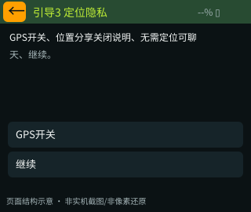

**入口：** 引导2 地区预设确认。

**使用场景：** 决定是否启用定位，了解位置分享规则。

| 页面组件 | 占比 | 色彩 | 交互方式 | 功能 |
| --- | --- | --- | --- | --- |
| 状态栏与返回键 | 2/20 | 深绿底；黄绿标题；浅灰状态；橙色返回键 | 显示；点击 | 显示页面标题、电量百分比和电池图标。 点击左上橙色箭头：引导2 地区预设。 |
| 定位说明区 | 5/20 | 暗色背景；浅色正文；灰色说明 | 查看 | 说明是否定位由用户选择。 |
| 定位开关区 | 5/20 | 深色卡片；浅色文字；黄绿色重点 | 点击 | • **GPS开关**：暂存设置，不立即上电 |
| 隐私说明区 | 4/20 | 暗色背景；浅色正文；灰色说明 | 查看 | 自动分享位置默认关闭，无需定位也能聊天。 |
| 继续 | 4/20 | 黄绿色按钮；深色文字 | 点击 | • **继续**：引导4 确认开始 |

**返回：** 引导2 地区预设。

### 17 引导4 确认开始

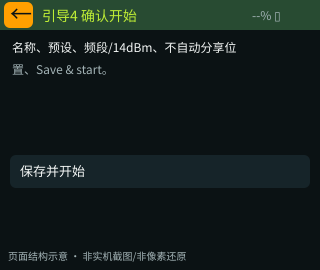

**入口：** 引导3 定位隐私 → 继续。

**使用场景：** 检查设置，确认后开始使用设备。

| 页面组件 | 占比 | 色彩 | 交互方式 | 功能 |
| --- | --- | --- | --- | --- |
| 状态栏与返回键 | 2/20 | 深绿底；黄绿标题；浅灰状态；橙色返回键 | 显示；点击 | 显示页面标题、电量百分比和电池图标。 点击左上橙色箭头：引导3 定位隐私。 |
| 设置摘要区 | 14/20 | 暗色背景；浅色正文；灰色说明 | 查看 | 展示设备名称、所选地区预设和位置分享规则。 |
| 保存并开始 | 4/20 | 黄绿色按钮；深色文字 | 点击 | • **保存并开始**：保存设置并进入首页（地区已选择，设置保存成功） |

**返回：** 引导3 定位隐私。

**补充规则：** 保存成功后进入首页，并按用户选择开启GPS；失败时提示原因，保留待确认状态。

### 18 通用输入

**入口：** 名称；手工联系人；新频道。

**使用场景：** 填写名称、联系人公钥或频道资料。

| 页面组件 | 占比 | 色彩 | 交互方式 | 功能 |
| --- | --- | --- | --- | --- |
| 状态栏与返回键 | 2/20 | 深绿底；黄绿标题；浅灰状态；橙色返回键 | 显示；点击 | 显示页面标题、电量百分比和电池图标。 点击左上橙色箭头：输入前的页面；私有密钥取消回新增频道类型。 |
| 输入内容区 | 4/20 | 暗底；青色边框；浅色文字 | 查看编辑结果 | 显示正在编辑的内容，较长时显示末尾，避免挤占键盘。 |
| 长度提示区 | 1/20 | 灰色说明；超限时强调提示 | 查看 | 显示输入长度与当前允许上限。 |
| 键盘与编辑工具 | 9/20 | 深色卡片；浅色文字；黄绿色重点 | 点击输入 | 字母、数字和符号键盘；大小写、空格、删除等工具。 • **字符键**：追加 • **Aa**：大小写 • **123**：符号 • **Space**：空格 • **<-**：删除文字字符 |
| 完成操作区 | 4/20 | 黄绿色按钮；深色文字 | 点击 | • **Done / 继续**：检查输入内容，进入下一步或返回输入前的页面（内容非空且符合当前填写项要求） |

**返回：** 输入前的页面；私有密钥取消回新增频道类型。

**补充规则：** 内容不符合要求时给出错误提示并保留输入；长度、公钥、共享密钥、重复名称等要求见对应输入场景。

### 19 表情选择

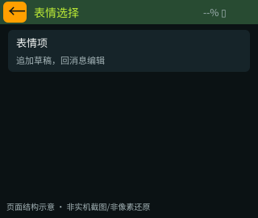

**入口：** 消息编辑 → 表情选择。

**使用场景：** 用简短表情补充消息。

| 页面组件 | 占比 | 色彩 | 交互方式 | 功能 |
| --- | --- | --- | --- | --- |
| 状态栏与返回键 | 2/20 | 深绿底；黄绿标题；浅灰状态；橙色返回键 | 显示；点击 | 显示页面标题、电量百分比和电池图标。 点击左上橙色箭头：消息编辑。 |
| 可选内容列表 | 18/20 | 深色卡片；浅色文字；黄绿色重点 | 上下滑动；点击 | 微笑、确认、等待、位置、警告五个名称项；点击后插入对应表情。 • **表情项**：追加草稿，回消息编辑 |

**返回：** 消息编辑。

**补充规则：** 当前为名称列表。

### 20 二次确认

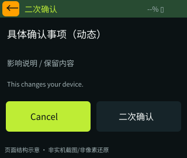

**入口：** 删除轨迹/航点、关闭BLE、管理、Sleep。

**使用场景：** 执行有影响的操作前，核对内容并选择继续或取消。

| 页面组件 | 占比 | 色彩 | 交互方式 | 功能 |
| --- | --- | --- | --- | --- |
| 状态栏与返回键 | 2/20 | 深绿底；黄绿标题；浅灰状态；橙色返回键 | 显示；点击 | 显示页面标题、电量百分比和电池图标。 点击左上橙色箭头：返回等效取消，回发起确认的页面。 |
| 确认内容区 | 14/20 | 暗色背景；浅色正文；灰色说明 | 查看 | 展示本次操作及其影响，避免误操作。 |
| 取消与确认区 | 4/20 | 深色卡片；浅色文字；黄绿色重点；当前取消为黄绿色 | 点击 | • **取消**：回来源，不执行 • **确认**：执行本次确认的操作，结果见二次确认表 |

**返回：** 返回等效取消，回发起确认的页面。

**补充规则：** 确认页面占满屏幕，暂时不能打开主导航。取消按钮为绿色，确认按钮使用普通按钮颜色；该主次关系列入产品讨论。

### 21 消息详情

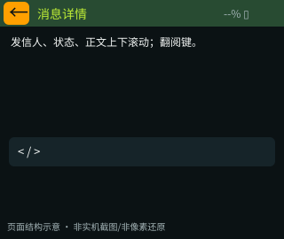

**入口：** 会话消息卡。

**使用场景：** 阅读完整消息正文和投递状态。

| 页面组件 | 占比 | 色彩 | 交互方式 | 功能 |
| --- | --- | --- | --- | --- |
| 状态栏与返回键 | 2/20 | 深绿底；黄绿标题；浅灰状态；橙色返回键 | 显示；点击 | 显示页面标题、电量百分比和电池图标。 点击左上橙色箭头：会话。 |
| 发信人与状态区 | 3/20 | 暗色背景；浅色正文；灰色说明 | 查看 | 显示消息来源和投递状态。 |
| 完整正文区 | 12/20 | 暗色背景；浅色正文；灰色说明 | 上下滑动 | 浏览完整正文；消息已被淘汰时显示提示。 |
| 翻阅操作区 | 3/20 | 深色卡片；浅色文字；黄绿色重点 | 点击 | • **< / >**：前后约100px |

**返回：** 会话。

**补充规则：** 历史淘汰后提示不在历史中。

### 22 快捷短语

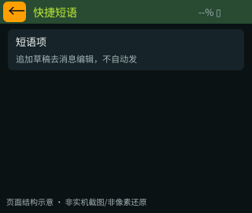

**入口：** 会话 → 快捷回复；消息编辑 → 短语。

**使用场景：** 用常用短语快速回复，再进入编辑确认。

| 页面组件 | 占比 | 色彩 | 交互方式 | 功能 |
| --- | --- | --- | --- | --- |
| 状态栏与返回键 | 2/20 | 深绿底；黄绿标题；浅灰状态；橙色返回键 | 显示；点击 | 显示页面标题、电量百分比和电池图标。 点击左上橙色箭头：固定消息编辑，即使来自会话。 |
| 可选内容列表 | 18/20 | 深色卡片；浅色文字；黄绿色重点 | 上下滑动；点击 | OK, understood. / On my way. / Please wait. / I have arrived. / Please share your location. 五项。 • **短语项**：追加草稿去消息编辑，不自动发 |

**返回：** 固定消息编辑，即使来自会话。

**补充规则：** 从会话进入先载入目标草稿。

### 23 硬件状态

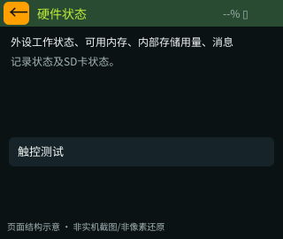

**入口：** 高级设置；应用列表/首页快捷入口。

**使用场景：** 检查设备运行、存储和外设状态。

| 页面组件 | 占比 | 色彩 | 交互方式 | 功能 |
| --- | --- | --- | --- | --- |
| 状态栏与返回键 | 2/20 | 深绿底；黄绿标题；浅灰状态；橙色返回键 | 显示；点击 | 显示页面标题、电量百分比和电池图标。 点击左上橙色箭头：进入本页前的页面。 |
| 硬件与存储状态区 | 14/20 | 暗色背景；浅色正文；灰色说明 | 查看 | 外设工作状态、可用内存、内部存储用量、消息记录状态及SD卡状态。 |
| 测试入口区 | 4/20 | 深色卡片；浅色文字；黄绿色重点 | 点击 | • **触控测试**：触控测试 |

**返回：** 进入本页前的页面。

**补充规则：** 均为真实硬件值。

### 24 触控测试

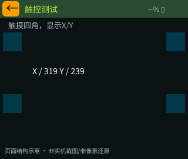

**入口：** 硬件状态 → 触控测试。

**使用场景：** 检查触摸位置是否准确。

| 页面组件 | 占比 | 色彩 | 交互方式 | 功能 |
| --- | --- | --- | --- | --- |
| 状态栏与返回键 | 2/20 | 深绿底；黄绿标题；浅灰状态；橙色返回键 | 显示；点击 | 显示页面标题、电量百分比和电池图标。 点击左上橙色箭头：固定硬件状态。 |
| 测试说明区 | 3/20 | 暗色背景；浅色正文；灰色说明 | 查看 | 提示依次触摸四个角。 |
| 触控测试画布 | 15/20 | 暗色底；黄绿色目标框和触摸标记 | 点击四角；查看反馈 | 显示触摸位置和坐标，用于判断是否准确。 |

**返回：** 固定硬件状态。

**补充规则：** 仅显示坐标，无重新校准/保存矩阵按钮。

### 25 音频主页

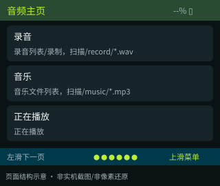

**入口：** 底部音频主页；左右滑动；应用列表/快捷入口。

**使用场景：** 选择录音、音乐或返回正在播放的内容。

| 页面组件 | 占比 | 色彩 | 交互方式 | 功能 |
| --- | --- | --- | --- | --- |
| 状态栏 | 2/20 | 深绿底；黄绿标题；浅灰状态 | 显示 | 显示页面标题、电量百分比和电池图标。 |
| 音频功能入口 | 15/20 | 深色卡片；浅色文字；黄绿色重点 | 上下滑动；点击 | 录音、音乐两个入口；选择过音轨后增加正在播放入口。 • **录音**：录音列表/录制，扫描/record/*.wav • **音乐**：音乐文件列表，扫描/music/*.mp3 • **正在播放**：正在播放（已有音轨） |
| 底部菜单提示区 | 3/20 | 深青底；浅灰提示；黄绿色标记 | 左右滑动；底边上滑 | 显示所在页面和手势提示；左滑下一页，右滑上一页；底边上滑打开六项主导航。 |

**返回：** 第5个主页面，无返回。

**补充规则：** 播放器回列表不断播放；录音列表返回音频主页会停止录制。

### 26 公开频道列表

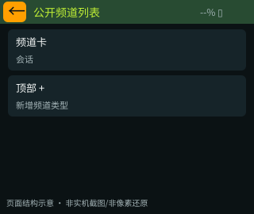

**入口：** 消息首页 → 公开频道。

**使用场景：** 找到默认公开频道或其他公开频道。

| 页面组件 | 占比 | 色彩 | 交互方式 | 功能 |
| --- | --- | --- | --- | --- |
| 状态栏与返回键 | 2/20 | 深绿底；黄绿标题；浅灰状态；橙色返回键 | 显示；点击 | 显示页面标题、电量百分比和电池图标。 点击左上橙色箭头：固定消息首页。 • **顶部 +**：新增频道类型 |
| 频道列表 | 18/20 | 深色卡片；浅色文字；黄绿色重点 | 上下滑动；点击 | 默认Public与已保存#频道；频道名/会话说明；右上+。 • **频道卡**：会话 |

**返回：** 固定消息首页。

**补充规则：** 包括默认公开频道和用户添加的公开频道；最多可保存40个频道。

### 27 私有频道列表

**入口：** 消息首页 → 私有频道。

**使用场景：** 选择使用共享密钥的频道。

| 页面组件 | 占比 | 色彩 | 交互方式 | 功能 |
| --- | --- | --- | --- | --- |
| 状态栏与返回键 | 2/20 | 深绿底；黄绿标题；浅灰状态；橙色返回键 | 显示；点击 | 显示页面标题、电量百分比和电池图标。 点击左上橙色箭头：固定消息首页。 • **顶部 +**：新增频道类型 |
| 频道列表 | 18/20 | 深色卡片；浅色文字；黄绿色重点 | 上下滑动；点击 | 共享密钥频道；空态提示+；右上+。 • **频道卡**：会话 |

**返回：** 固定消息首页。

**补充规则：** 无额外频道密码解锁页。

### 28 消息中的联系人

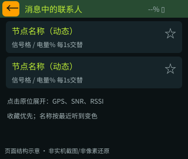

**入口：** 消息首页 → 联系人主页。

**使用场景：** 选择聊天联系人并进入私聊。

| 页面组件 | 占比 | 色彩 | 交互方式 | 功能 |
| --- | --- | --- | --- | --- |
| 状态栏与返回键 | 2/20 | 深绿底；黄绿标题；浅灰状态；橙色返回键 | 显示；点击 | 显示页面标题、电量百分比和电池图标。 点击左上橙色箭头：固定消息首页。 • **顶部 +**：新增频道类型（当前版本） |
| 联系人卡片 | 18/20 | 深色卡片；浅色文字；黄绿色重点 | 上下滑动；点击 | 名称固定显示；近期可见为绿色，否则红色。信号格与电量每1秒交替；点击卡片原位展开位置、SNR、RSSI；星标点亮后置顶。 • **节点卡**：原位展开/收起 • **星标**：收藏保存 • **展开Message**：私聊会话 |

**返回：** 固定消息首页。

**补充规则：** 此+不是新增联系人；手工添加在联系人主页 → 新增。

### 29 基础设置

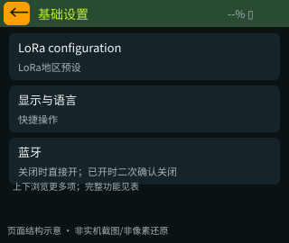

**入口：** 设置首页 → 基础设置。

**使用场景：** 完成日常设置，便于新用户使用。

| 页面组件 | 占比 | 色彩 | 交互方式 | 功能 |
| --- | --- | --- | --- | --- |
| 状态栏与返回键 | 2/20 | 深绿底；黄绿标题；浅灰状态；橙色返回键 | 显示；点击 | 显示页面标题、电量百分比和电池图标。 点击左上橙色箭头：固定设置首页。 |
| 设置列表 | 18/20 | 深色卡片；浅色文字；黄绿色重点 | 上下滑动；点击 | 按顺序：LoRa配置、显示与语言、蓝牙、设备名称、提示音、音量增加、音量降低、关于设备；上下浏览。 • **LoRa configuration**：LoRa地区预设 • **显示与语言**：快捷操作 • **蓝牙**：关闭时直接开；已开时二次确认关闭（USB版仅提示需BLE版） • **设备名称**：通用输入 设备名称 • **提示音**：静音开关保存；启用可播ACK音 • **音量增加/降低**：每次±10%，0～100%，保存 • **关于设备**：关于设备 |

**返回：** 固定设置首页。

### 30 高级设置

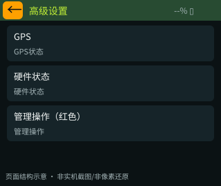

**入口：** 设置首页 → 高级设置。

**使用场景：** 进入定位、硬件状态和管理功能。

| 页面组件 | 占比 | 色彩 | 交互方式 | 功能 |
| --- | --- | --- | --- | --- |
| 状态栏与返回键 | 2/20 | 深绿底；黄绿标题；浅灰状态；橙色返回键 | 显示；点击 | 显示页面标题、电量百分比和电池图标。 点击左上橙色箭头：固定设置首页。 |
| 设置列表 | 18/20 | 深色卡片；浅色文字；黄绿色重点 | 上下滑动；点击 | GPS、Hardware status、红色管理操作。 • **GPS**：GPS状态 • **硬件状态**：硬件状态 • **管理操作（红色）**：管理操作 |

**返回：** 固定设置首页。

### 31 录音列表/录制

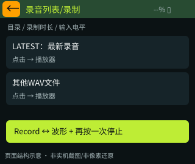

**入口：** 音频主页 → 录音。

**使用场景：** 录制语音，停止保存后选择录音回放。

| 页面组件 | 占比 | 色彩 | 交互方式 | 功能 |
| --- | --- | --- | --- | --- |
| 状态栏与返回键 | 2/20 | 深绿底；黄绿标题；浅灰状态；橙色返回键 | 显示；点击 | 显示页面标题、电量百分比和电池图标。 点击左上橙色箭头：固定音频主页；在录则停止保存。 |
| 录制状态与时长 | 3/20 | 灰色路径；录制时黄绿色时长与电平 | 查看 | 空闲时显示目录，录制时显示录音时长和声音电平。 |
| 录音文件列表 | 11/20 | 深色卡片；浅色文字；黄绿色重点 | 上下滑动；点击 | 最新完成录音置顶并标注最新；点击文件进入播放器。 • **录音文件卡**：正在播放原生WAV回放（录制时禁用） |
| 录音控制栏 | 4/20 | 黄绿色按钮；深色文字 | 点击一次开始；再次点击停止 | 同一按钮在开始录音与波形加停止提示之间切换，不另设停止按钮。 • **开始录音**：开始录制；按钮变波形+Press again to stop（SD可写、≥1MB空间、无音频占用） • **波形+再按一次停止**：保存并刷新列表回顶部 |

**返回：** 固定音频主页；在录则停止保存。

**补充规则：** 单次最长30分钟，录音列表最多显示128项。最新完成录音置顶；录制期间不能点播其他文件。保存后可直接进入播放器回放。录音与停止使用同一个按钮。

### 32 音乐文件列表

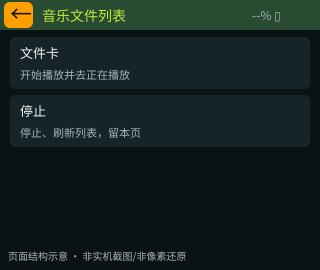

**入口：** 音频主页 → 音乐文件列表；快捷入口。

**使用场景：** 选择SD卡上的音乐并开始播放。

| 页面组件 | 占比 | 色彩 | 交互方式 | 功能 |
| --- | --- | --- | --- | --- |
| 状态栏与返回键 | 2/20 | 深绿底；黄绿标题；浅灰状态；橙色返回键 | 显示；点击 | 显示页面标题、电量百分比和电池图标。 点击左上橙色箭头：固定音频主页。 |
| 目录与播放状态 | 2/20 | 暗色背景；浅色正文；灰色说明 | 查看 | 显示音乐目录或当前播放状态。 |
| 音乐文件列表 | 13/20 | 深色卡片；浅色文字；黄绿色重点 | 上下滑动；点击 | /music/*.mp3列表；底部Stop。 • **文件卡**：开始播放并去正在播放 |
| 停止操作区 | 3/20 | 深色卡片；浅色文字；黄绿色重点 | 点击 | • **停止**：停止、刷新列表，留本页 |

**返回：** 固定音频主页。

**补充规则：** MP3不是MP4；无删除/重命名/播放列表编辑。

### 33 新增频道类型

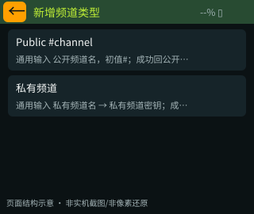

**入口：** 消息首页 新增；列表+；快捷入口。

**使用场景：** 选择公开或私有类型并填写新频道资料。

| 页面组件 | 占比 | 色彩 | 交互方式 | 功能 |
| --- | --- | --- | --- | --- |
| 状态栏与返回键 | 2/20 | 深绿底；黄绿标题；浅灰状态；橙色返回键 | 显示；点击 | 显示页面标题、电量百分比和电池图标。 点击左上橙色箭头：固定消息首页。 |
| 频道类型选择区 | 18/20 | 深色卡片；浅色文字；黄绿色重点 | 上下滑动；点击 | Public #channel / 私有频道两卡。 • **Public #channel**：通用输入 公开频道名，初值#；成功回公开频道列表 • **私有频道**：通用输入 私有频道名 → 私有频道密钥；成功回私有频道列表 |

**返回：** 固定消息首页。

**补充规则：** 创建成功后返回对应频道列表，再点击频道进入会话。名称或密钥重复、格式不正确或已满时提示，不覆盖现有频道。

### 34 正在播放

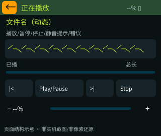

**入口：** 音乐文件列表/录音列表/录制点击文件；音频主页 → 正在播放。

**使用场景：** 控制当前音频的播放进度、曲目和音量。

| 页面组件 | 占比 | 色彩 | 交互方式 | 功能 |
| --- | --- | --- | --- | --- |
| 状态栏与返回键 | 2/20 | 深绿底；黄绿标题；浅灰状态；橙色返回键 | 显示；点击 | 显示页面标题、电量百分比和电池图标。 点击左上橙色箭头：按所选音轨类型回音乐文件列表/录音列表/录制，播放继续。 |
| 曲目信息与状态 | 4/20 | 暗色背景；浅色正文；灰色说明 | 查看 | 显示文件名和播放、暂停、停止或错误状态。 |
| 声音波形区 | 3/20 | 深色卡片；黄绿色波形 | 查看 | 展示声音波形，不使用虚构频谱。 |
| 时长与进度区 | 3/20 | 深青进度轨；黄绿色进度 | 点击；拖动 | 显示已播和总时长，调整播放位置。 • **进度点击/拖动**：松手定位，不触发切页 |
| 播放控制栏 | 4/20 | 深色卡片；浅色文字；黄绿色重点；播放暂停为黄绿色 | 点击 | • **上一首 / 下一首**：当前库前后曲、首尾循环 • **Play / Pause**：暂停/继续；停止后重新开始 • **停止**：停止，保留选择和本页 |
| 音量控制栏 | 4/20 | 黄绿色滑杆；浅色百分比 | 点击；拖动 | • **音量滑杆**：实时0～100%，松手保存 • **- / +**：每次±10%并保存 |

**返回：** 按所选音轨类型回音乐文件列表/录音列表/录制，播放继续。

**补充规则：** 可暂停、停止、切换上一首/下一首、拖动进度和音量；当前文件列表首尾循环。MP3跳转和部分文件时长为估算，不承诺精确到秒；接近静音时给出提示。

### 35 轨迹管理

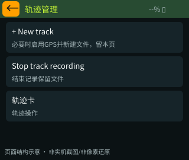

**入口：** 地图菜单轨迹；应用列表；快捷入口。

**使用场景：** 新增轨迹记录，或选择已保存轨迹进行操作。

| 页面组件 | 占比 | 色彩 | 交互方式 | 功能 |
| --- | --- | --- | --- | --- |
| 状态栏与返回键 | 2/20 | 深绿底；黄绿标题；浅灰状态；橙色返回键 | 显示；点击 | 显示页面标题、电量百分比和电池图标。 点击左上橙色箭头：进入本页前的页面。 |
| 轨迹记录控制区 | 4/20 | 黄绿色按钮；深色文字 | 点击 | 新增轨迹与停止记录使用同一个入口。 • **+ New track**：必要时启用GPS并新建文件，留本页（SD可写；无定位等待） • **Stop track recording**：结束记录保留文件 |
| 已保存轨迹列表 | 14/20 | 深色卡片；浅色文字；黄绿色重点 | 上下滑动；点击 | 新增/停止记录单按钮；CSV列表；空态仅记录真实定位。 • **轨迹卡**：轨迹操作 |

**返回：** 进入本页前的页面。

**补充规则：** 文件保存在SD卡的轨迹目录。每5秒记录一次新的有效位置；没有定位时等待，不写入虚假位置。列表最多显示32条。轨迹记录与声音录制分别控制。

### 36 轨迹操作

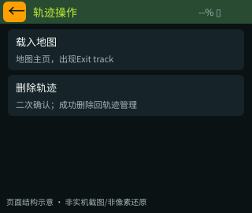

**入口：** 轨迹管理点击轨迹。

**使用场景：** 将轨迹载入地图，或删除不再需要的轨迹。

| 页面组件 | 占比 | 色彩 | 交互方式 | 功能 |
| --- | --- | --- | --- | --- |
| 状态栏与返回键 | 2/20 | 深绿底；黄绿标题；浅灰状态；橙色返回键 | 显示；点击 | 显示页面标题、电量百分比和电池图标。 点击左上橙色箭头：固定轨迹管理。 |
| 选中项目名称 | 4/20 | 暗色背景；浅色正文；灰色说明 | 查看 | 显示当前选中的轨迹或航点。 |
| 查看与删除操作区 | 14/20 | 深色卡片；浅色文字；黄绿色重点；删除名称红色 | 点击 | 删除前需要二次确认。 • **载入地图**：地图主页，出现Exit track • **删除轨迹**：二次确认；成功删除回轨迹管理（同一正在记录轨迹禁止删） |

**返回：** 固定轨迹管理。

**补充规则：** 单个轨迹文件不超过4MB；地图展示轨迹概览，保留原始文件。没有有效定位点时提示无法载入；正在记录的轨迹不能删除。

### 37 航点列表

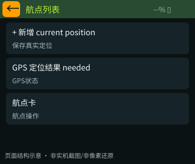

**入口：** 地图航点；应用列表；快捷入口。

**使用场景：** 保存当前位置，或浏览已保存地点。

| 页面组件 | 占比 | 色彩 | 交互方式 | 功能 |
| --- | --- | --- | --- | --- |
| 状态栏与返回键 | 2/20 | 深绿底；黄绿标题；浅灰状态；橙色返回键 | 显示；点击 | 显示页面标题、电量百分比和电池图标。 点击左上橙色箭头：进入本页前的页面。 |
| 保存当前位置区 | 4/20 | 黄绿色按钮；深色文字 | 点击 | 没有有效定位时改为打开定位状态入口。 • **+ 新增 current position**：保存真实定位（有效定位结果且未满24） • **GPS 定位结果 needed**：GPS状态（无有效定位） |
| 已保存航点列表 | 14/20 | 深色卡片；浅色文字；黄绿色重点 | 上下滑动；点击 | 保存当前位置；名称/坐标卡；无定位结果时主按钮改打开GPS。 • **航点卡**：航点操作 |

**返回：** 进入本页前的页面。

**补充规则：** 最多保存24个航点；默认自动命名。当前不支持修改名称或手动输入经纬度。

### 38 航点操作

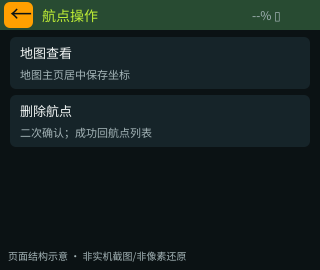

**入口：** 航点列表点击航点。

**使用场景：** 在地图中查看航点，或删除该航点。

| 页面组件 | 占比 | 色彩 | 交互方式 | 功能 |
| --- | --- | --- | --- | --- |
| 状态栏与返回键 | 2/20 | 深绿底；黄绿标题；浅灰状态；橙色返回键 | 显示；点击 | 显示页面标题、电量百分比和电池图标。 点击左上橙色箭头：固定航点列表。 |
| 选中项目名称 | 4/20 | 暗色背景；浅色正文；灰色说明 | 查看 | 显示当前选中的轨迹或航点。 |
| 查看与删除操作区 | 14/20 | 深色卡片；浅色文字；黄绿色重点；删除名称红色 | 点击 | 删除前需要二次确认。 • **地图查看**：地图主页居中保存坐标 • **删除航点**：二次确认；成功回航点列表 |

**返回：** 固定航点列表。

### 39 离线瓦片

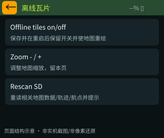

**入口：** 地图离线地图；应用列表 → 离线瓦片。

**使用场景：** 检查离线地图读取方式、开关和缩放。

| 页面组件 | 占比 | 色彩 | 交互方式 | 功能 |
| --- | --- | --- | --- | --- |
| 状态栏与返回键 | 2/20 | 深绿底；黄绿标题；浅灰状态；橙色返回键 | 显示；点击 | 显示页面标题、电量百分比和电池图标。 点击左上橙色箭头：进入本页前的页面。 |
| 离线地图开关 | 4/20 | 深色卡片；浅色文字；黄绿色重点 | 点击 | • **Offline tiles on/off**：保存并在重启后保留开关并使地图重绘 |
| 地图目录说明 | 6/20 | 暗色背景；浅色正文；灰色说明 | 查看 | 说明从SD卡/map目录读取地图，并显示当前需要的文件位置。 |
| 缩放操作区 | 4/20 | 深色卡片；浅色文字；黄绿色重点 | 点击 | • **Zoom - / +**：调整地图缩放，留本页 |
| 重新读取区 | 4/20 | 深色卡片；浅色文字；黄绿色重点 | 点击 | • **Rescan SD**：重读相关地图数据/轨迹/航点并提示 |

**返回：** 进入本页前的页面。

**补充规则：** 从SD卡的/map目录读取地图；无地图时显示栅格。支持缩放3～18级的标准图片瓦片，当前不提供在线下载或其他地图文件格式导入。旧目录文件需由用户自行整理。

### 40 GPS状态

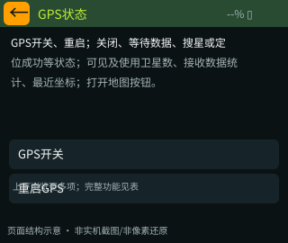

**入口：** 应用列表；高级设置 GPS；地图条；罗盘；无定位结果航点入口。

**使用场景：** 查看定位进度，必要时重启定位。

| 页面组件 | 占比 | 色彩 | 交互方式 | 功能 |
| --- | --- | --- | --- | --- |
| 状态栏与返回键 | 2/20 | 深绿底；黄绿标题；浅灰状态；橙色返回键 | 显示；点击 | 显示页面标题、电量百分比和电池图标。 点击左上橙色箭头：进入本页前的页面。 |
| 定位开关与重启 | 4/20 | 深色卡片；浅色文字；黄绿色重点 | 点击 | • **GPS开关**：电源切换并保存 • **重启GPS**：复位、清有效状态和旧航向（已开启） |
| 定位状态区 | 9/20 | 暗色背景；浅色正文；灰色说明 | 查看 | 显示等待数据、搜星、定位成功、卫星数量和数据接收状态。 |
| 最近位置区 | 2/20 | 暗色背景；浅色正文；灰色说明 | 查看 | 有位置时显示坐标，无位置时显示等待提示。 |
| 打开地图 | 3/20 | 深色卡片；浅色文字；黄绿色重点 | 点击 | • **打开地图**：地图主页 |

**返回：** 进入本页前的页面。

**补充规则：** 无位置时显示等待定位；已取得过位置时保留最近坐标，地图区分当前位置与过期位置。

### 41 应用列表

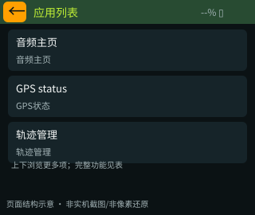

**入口：** 首页 → 应用列表。

**使用场景：** 集中进入音频、定位和其他设备工具。

| 页面组件 | 占比 | 色彩 | 交互方式 | 功能 |
| --- | --- | --- | --- | --- |
| 状态栏与返回键 | 2/20 | 深绿底；黄绿标题；浅灰状态；橙色返回键 | 显示；点击 | 显示页面标题、电量百分比和电池图标。 点击左上橙色箭头：进入本页前的页面，通常首页。 |
| 应用入口列表 | 18/20 | 深色卡片；浅色文字；黄绿色重点 | 上下滑动；点击 | 按顺序为：音频、GPS状态、轨迹、航点、离线地图、快捷操作、关于设备、指南针、截屏；上下滑动浏览。 • **音频主页**：音频主页 • **GPS status**：GPS状态 • **轨迹管理**：轨迹管理 • **航点列表**：航点列表 • **离线瓦片**：离线瓦片 • **快捷操作 panel**：快捷操作 • **关于设备**：关于设备 • **GPS行进罗盘**：GPS行进罗盘 • **截屏**：截屏设置 |

**返回：** 进入本页前的页面，通常首页。

**补充规则：** 这是首页内的应用列表，通过上下滑动浏览；不增加横向主页面数量。

### 42 管理操作

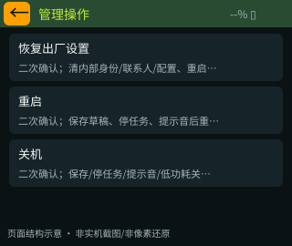

**入口：** 高级设置 → 红色管理操作。

**使用场景：** 进行重启、关机或恢复出厂等管理操作。

| 页面组件 | 占比 | 色彩 | 交互方式 | 功能 |
| --- | --- | --- | --- | --- |
| 状态栏与返回键 | 2/20 | 深绿底；黄绿标题；浅灰状态；橙色返回键 | 显示；点击 | 显示页面标题、电量百分比和电池图标。 点击左上橙色箭头：进入本页前的页面，通常为高级设置。 |
| 恢复出厂设置 | 6/20 | 深色底；红色操作名称 | 点击后进入二次确认 | • **恢复出厂设置**：二次确认；清内部身份/联系人/配置、重启，SD保留 |
| 重启设备 | 6/20 | 深色底；红色操作名称 | 点击后进入二次确认 | • **重启**：二次确认；保存草稿、停任务、提示音后重启 |
| 关机 | 6/20 | 深色底；红色操作名称 | 点击后进入二次确认 | • **关机**：二次确认；保存/停任务/提示音/低功耗关机 |

**返回：** 进入本页前的页面，通常为高级设置。

**补充规则：** 关机为低功耗休眠，可使用BOOT键唤醒；恢复出厂会清除内部身份、联系人和设置，保留SD文件。

### 43 GPS行进罗盘

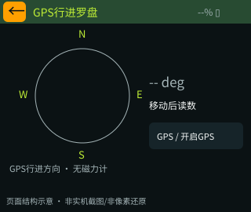

**入口：** 应用列表 → GPS行进罗盘。

**使用场景：** 移动时判断GPS行进方向。

| 页面组件 | 占比 | 色彩 | 交互方式 | 功能 |
| --- | --- | --- | --- | --- |
| 状态栏与返回键 | 2/20 | 深绿底；黄绿标题；浅灰状态；橙色返回键 | 显示；点击 | 显示页面标题、电量百分比和电池图标。 点击左上橙色箭头：进入本页前的页面，通常为应用列表。 |
| 罗盘与行进信息区 | 14/20 | 暗色底；浅灰刻度；黄绿与红色指针 | 查看 | 显示方向盘、行进角度和速度；静止或无有效方向时显示未知。 |
| 定位入口与限制提示 | 4/20 | 深色卡片；浅色文字；黄绿色重点 | 点击；查看说明 | 说明依赖GPS行进方向，不能测静止朝向。 • **Enable GPS**：开启GPS保存，留本页（GPS关闭时） • **GPS status**：GPS状态（GPS开启时） |

**返回：** 进入本页前的页面，通常为应用列表。

**补充规则：** 使用GPS行进方向，需要有效定位并移动约1.9km/h以上。静止或方向过期时显示未知并提示移动。设备没有磁力计，因此不显示静止时设备朝向。

### 44 截屏设置

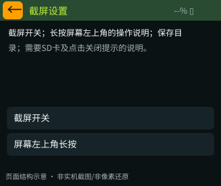

**入口：** 应用列表 → 截屏。

**使用场景：** 开启截屏，保存当前画面用于记录和反馈。

| 页面组件 | 占比 | 色彩 | 交互方式 | 功能 |
| --- | --- | --- | --- | --- |
| 状态栏与返回键 | 2/20 | 深绿底；黄绿标题；浅灰状态；橙色返回键 | 显示；点击 | 显示页面标题、电量百分比和电池图标。 点击左上橙色箭头：进入本页前的页面，通常为应用列表。 |
| 截屏开关 | 4/20 | 深色卡片；浅色文字；黄绿色重点 | 点击 | • **截屏开关**：保存并在重启后保留开关，默认关 |
| 操作说明区 | 8/20 | 暗色背景；浅色正文；灰色说明 | 查看 | 长按左上角约1.2秒；移动取消；短按返回仍有效。 |
| 保存目录与结果说明 | 6/20 | 暗色背景；浅色正文；灰色说明 | 查看 | 图片保存到SD卡截屏目录，成功提示需点击关闭。 |
| 全局截屏触发区 | 悬浮叠加 | 沿用当前页面；成功提示为深青色 | 左上角长按 | 该触发区叠加在页面左上方，不额外占用布局。 • **屏幕左上角长按**：保存当前画面，成功后显示文件位置提示（已开启截屏，手指在屏幕左上角保持约1.2秒且不移动） |

**返回：** 进入本页前的页面，通常为应用列表。

**补充规则：** 默认关闭；开启后长按屏幕左上角约1.2秒，一次按下只截一张；手指移动取消。成功后显示文件位置，点击关闭提示。SD不可用或保存失败时显示错误，不显示成功。

## 6. 填写信息的六种场景

各场景共用输入键盘，根据任务显示不同标题、校验要求和完成目标。

| 填写项 | 要求 | 完成后 |
| --- | --- | --- |
| 设备名称 | 不超过31字节 | 返回编辑前页面；引导期间最后统一保存 |
| 联系人公钥 | 完整64位十六进制，不得重复 | 继续填写联系人名称 |
| 联系人名称 | 不超过31字节 | 保存联系人，回联系人主页 |
| 公开频道名 | 以#开头，后面不能为空，不超过31字节 | 保存成功回公开频道列表 |
| 私有频道名 | 不超过31字节 | 继续填写共享密钥 |
| 私有频道共享密钥 | 完整32位十六进制 | 保存成功回私有频道列表 |

目前长度按存储字节计数，不等同所有语言的可输入字数。是否改用更直观的字数提示，列入讨论项。

### 设备名称

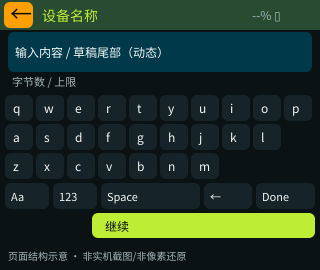
| 页面组件 | 占比 | 色彩 | 交互方式 | 功能 |
| --- | --- | --- | --- | --- |
| 状态栏与返回键 | 2/20 | 深绿底；黄绿标题；浅灰状态；橙色返回键 | 显示；点击 | 显示页面标题、电量百分比和电池图标。 点击左上橙色箭头：输入前的页面；私有密钥取消回新增频道类型。 |
| 输入内容区 | 4/20 | 暗底；青色边框；浅色文字 | 查看编辑结果 | 显示正在编辑的内容，较长时显示末尾，避免挤占键盘。 |
| 长度提示区 | 1/20 | 灰色说明；超限时强调提示 | 查看 | 显示输入长度与当前允许上限。 |
| 键盘与编辑工具 | 9/20 | 深色卡片；浅色文字；黄绿色重点 | 点击输入 | 字母、数字和符号键盘；大小写、空格、删除等工具。 • **字符键**：追加 • **Aa**：大小写 • **123**：符号 • **Space**：空格 • **<-**：删除文字字符 |
| 完成操作区 | 4/20 | 黄绿色按钮；深色文字 | 点击 | • **Done / 继续**：检查输入内容，进入下一步或返回输入前的页面（内容非空且符合当前填写项要求） |

### 联系人公钥

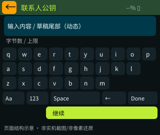
| 页面组件 | 占比 | 色彩 | 交互方式 | 功能 |
| --- | --- | --- | --- | --- |
| 状态栏与返回键 | 2/20 | 深绿底；黄绿标题；浅灰状态；橙色返回键 | 显示；点击 | 显示页面标题、电量百分比和电池图标。 点击左上橙色箭头：输入前的页面；私有密钥取消回新增频道类型。 |
| 输入内容区 | 4/20 | 暗底；青色边框；浅色文字 | 查看编辑结果 | 显示正在编辑的内容，较长时显示末尾，避免挤占键盘。 |
| 长度提示区 | 1/20 | 灰色说明；超限时强调提示 | 查看 | 显示输入长度与当前允许上限。 |
| 键盘与编辑工具 | 9/20 | 深色卡片；浅色文字；黄绿色重点 | 点击输入 | 字母、数字和符号键盘；大小写、空格、删除等工具。 • **字符键**：追加 • **Aa**：大小写 • **123**：符号 • **Space**：空格 • **<-**：删除文字字符 |
| 完成操作区 | 4/20 | 黄绿色按钮；深色文字 | 点击 | • **Done / 继续**：检查输入内容，进入下一步或返回输入前的页面（内容非空且符合当前填写项要求） |

### 联系人名称

| 页面组件 | 占比 | 色彩 | 交互方式 | 功能 |
| --- | --- | --- | --- | --- |
| 状态栏与返回键 | 2/20 | 深绿底；黄绿标题；浅灰状态；橙色返回键 | 显示；点击 | 显示页面标题、电量百分比和电池图标。 点击左上橙色箭头：输入前的页面；私有密钥取消回新增频道类型。 |
| 输入内容区 | 4/20 | 暗底；青色边框；浅色文字 | 查看编辑结果 | 显示正在编辑的内容，较长时显示末尾，避免挤占键盘。 |
| 长度提示区 | 1/20 | 灰色说明；超限时强调提示 | 查看 | 显示输入长度与当前允许上限。 |
| 键盘与编辑工具 | 9/20 | 深色卡片；浅色文字；黄绿色重点 | 点击输入 | 字母、数字和符号键盘；大小写、空格、删除等工具。 • **字符键**：追加 • **Aa**：大小写 • **123**：符号 • **Space**：空格 • **<-**：删除文字字符 |
| 完成操作区 | 4/20 | 黄绿色按钮；深色文字 | 点击 | • **Done / 继续**：检查输入内容，进入下一步或返回输入前的页面（内容非空且符合当前填写项要求） |

### 公开频道名

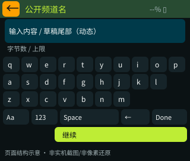
| 页面组件 | 占比 | 色彩 | 交互方式 | 功能 |
| --- | --- | --- | --- | --- |
| 状态栏与返回键 | 2/20 | 深绿底；黄绿标题；浅灰状态；橙色返回键 | 显示；点击 | 显示页面标题、电量百分比和电池图标。 点击左上橙色箭头：输入前的页面；私有密钥取消回新增频道类型。 |
| 输入内容区 | 4/20 | 暗底；青色边框；浅色文字 | 查看编辑结果 | 显示正在编辑的内容，较长时显示末尾，避免挤占键盘。 |
| 长度提示区 | 1/20 | 灰色说明；超限时强调提示 | 查看 | 显示输入长度与当前允许上限。 |
| 键盘与编辑工具 | 9/20 | 深色卡片；浅色文字；黄绿色重点 | 点击输入 | 字母、数字和符号键盘；大小写、空格、删除等工具。 • **字符键**：追加 • **Aa**：大小写 • **123**：符号 • **Space**：空格 • **<-**：删除文字字符 |
| 完成操作区 | 4/20 | 黄绿色按钮；深色文字 | 点击 | • **Done / 继续**：检查输入内容，进入下一步或返回输入前的页面（内容非空且符合当前填写项要求） |

### 私有频道名

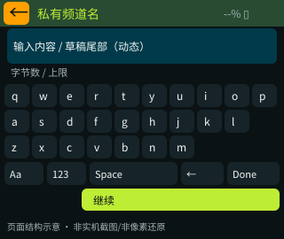
| 页面组件 | 占比 | 色彩 | 交互方式 | 功能 |
| --- | --- | --- | --- | --- |
| 状态栏与返回键 | 2/20 | 深绿底；黄绿标题；浅灰状态；橙色返回键 | 显示；点击 | 显示页面标题、电量百分比和电池图标。 点击左上橙色箭头：输入前的页面；私有密钥取消回新增频道类型。 |
| 输入内容区 | 4/20 | 暗底；青色边框；浅色文字 | 查看编辑结果 | 显示正在编辑的内容，较长时显示末尾，避免挤占键盘。 |
| 长度提示区 | 1/20 | 灰色说明；超限时强调提示 | 查看 | 显示输入长度与当前允许上限。 |
| 键盘与编辑工具 | 9/20 | 深色卡片；浅色文字；黄绿色重点 | 点击输入 | 字母、数字和符号键盘；大小写、空格、删除等工具。 • **字符键**：追加 • **Aa**：大小写 • **123**：符号 • **Space**：空格 • **<-**：删除文字字符 |
| 完成操作区 | 4/20 | 黄绿色按钮；深色文字 | 点击 | • **Done / 继续**：检查输入内容，进入下一步或返回输入前的页面（内容非空且符合当前填写项要求） |

### 私有频道密钥

| 页面组件 | 占比 | 色彩 | 交互方式 | 功能 |
| --- | --- | --- | --- | --- |
| 状态栏与返回键 | 2/20 | 深绿底；黄绿标题；浅灰状态；橙色返回键 | 显示；点击 | 显示页面标题、电量百分比和电池图标。 点击左上橙色箭头：输入前的页面；私有密钥取消回新增频道类型。 |
| 输入内容区 | 4/20 | 暗底；青色边框；浅色文字 | 查看编辑结果 | 显示正在编辑的内容，较长时显示末尾，避免挤占键盘。 |
| 长度提示区 | 1/20 | 灰色说明；超限时强调提示 | 查看 | 显示输入长度与当前允许上限。 |
| 键盘与编辑工具 | 9/20 | 深色卡片；浅色文字；黄绿色重点 | 点击输入 | 字母、数字和符号键盘；大小写、空格、删除等工具。 • **字符键**：追加 • **Aa**：大小写 • **123**：符号 • **Space**：空格 • **<-**：删除文字字符 |
| 完成操作区 | 4/20 | 黄绿色按钮；深色文字 | 点击 | • **Done / 继续**：检查输入内容，进入下一步或返回输入前的页面（内容非空且符合当前填写项要求） |

公开频道：选择公开类型 → 输入名称 → 保存 → 公开频道列表 → 点击频道进入会话。

私有频道：选择私有类型 → 输入名称 → 输入密钥 → 保存 → 私有频道列表。填写密钥时返回，当前会退出到新增频道类型选择。

手工联系人：联系人主页点击添加 → 输入公钥 → 输入名称 → 保存并返回联系人主页。

## 7. 菜单、选择窗与提示

### 底部主导航

**入口：** 底边上滑；BOOT短按。

**显示与交互：** 六个入口：首页、消息、联系人、地图、音频、设置。体积紧凑，显示在内容和局部菜单之上。

| 功能键/触发 | 用户操作后的结果 | 使用条件 |
| --- | --- | --- |
| 六个入口 | 对应主页面，关抽屉 | 常态可用 |
| 向下滑/窗外点 | 仅关闭，不穿透 | 常态可用 |
| 5s空闲 | 自动隐藏，按住不计超时 | 常态可用 |

### 首页快捷入口浮窗

**入口：** 首页底部+。

**显示与交互：** 4项/屏，上下滑看11候选；勾表示已添加；最多8项。

| 功能键/触发 | 用户操作后的结果 | 使用条件 |
| --- | --- | --- |
| 候选项 | 添加/移除；保存成功关窗并滚到底 | 常态可用 |
| 右上x/窗外点 | 关闭，不切页 | 常态可用 |

### 地图竖向菜单

**入口：** 地图右上三横线。

**显示与交互：** 轨迹/航点/离线地图，icon+名称。

| 功能键/触发 | 用户操作后的结果 | 使用条件 |
| --- | --- | --- |
| 轨迹 / 航点 / 离线地图 | 轨迹管理 / 航点列表 / 离线瓦片 | 常态可用 |
| 窗外点击 | 仅关闭，不点穿 | 常态可用 |

### 普通状态提示

**入口：** 保存/广播排队/蓝牙等。

**显示与交互：** 顶端312×108，Tap to dismiss；约2s自动过期；压在菜单之上。

| 功能键/触发 | 用户操作后的结果 | 使用条件 |
| --- | --- | --- |
| 点击任意处 | 关闭提示，不执行下面按钮 | 常态可用 |

### 截屏成功提示

**入口：** BMP成功写完并重命名。

**显示与交互：** Screenshot saved/截屏成功、实际路径、Tap to dismiss；不自动消失；锁屏也可关闭。

| 功能键/触发 | 用户操作后的结果 | 使用条件 |
| --- | --- | --- |
| 点击任意处 | 只关提示，原页面保持 | 常态可用 |

### 错误提示

**入口：** 参数/存储/SD/音频/发送失败。

**显示与交互：** 棕底/琥珀字，Tap to dismiss；不自动消失；全屏捕获点击。

| 功能键/触发 | 用户操作后的结果 | 使用条件 |
| --- | --- | --- |
| 点击任意处 | 关闭，不穿透 | 常态可用 |

### 快捷入口候选

最多可添加8个。当前候选为：地图、音频、轨迹、航点、GPS状态、LoRa配置、快捷操作、关于设备、音乐、新增频道、硬件状态。指南针和截屏目前从应用列表进入，是否加入候选可讨论。

### 二次确认后的结果

| 操作 | 取消 | 确认 |
| --- | --- | --- |
| 删除轨迹 | 返回轨迹操作页 | 删除成功回轨迹列表；正在记录的轨迹不可删 |
| 删除航点 | 返回航点操作页 | 删除成功回航点列表 |
| 关闭蓝牙 | 返回基础设置 | 断开连接并关闭蓝牙 |
| 恢复出厂 | 返回管理操作 | 清内部身份、联系人、设置并重启；保留SD文件 |
| 重启 | 返回管理操作 | 保存未完成内容、结束录制任务后重启 |
| 关机/休眠 | 返回原页面 | 保存未完成内容、结束任务并休眠，BOOT唤醒 |

## 8. 内容保存与文件位置

| 内容 | 用户可见规则 |
| --- | --- |
| 设置 | 名称、语言、时区、背光、定位与通信设置重启后保留；更新后可能需要重新确认通信预设 |
| 联系人 | 收藏保存并排在前面；不同联系人会话独立 |
| 频道 | 默认公开频道保留；最多40个频道 |
| 消息历史 | 所有会话合计最近48条；锁屏最多展示最新10条未读，每屏2条 |
| 草稿 | 最多保存12个会话的草稿；保存失败提示并保留输入 |
| 音量 | 0～100%，重启保留；加减按钮每次10%，也可拖动调整 |
| 地图 | SD卡/map目录，按/map/层级/x/y.png组织；缺失时显示栅格 |
| 轨迹 | SD卡/tracks目录；有有效定位才记录；载入、退出载入与删除分别控制 |
| 航点 | 保存在SD卡，最多24个；需有效定位才新增 |
| 录音 | SD卡/record目录，WAV格式；最长30分钟，最新录音置顶 |
| 音乐 | SD卡/music目录，MP3格式；列表最多128项 |
| 截屏 | SD卡/screenshots目录，BMP图片，320×240；不覆盖原图片 |
| SD异常 | 显示失败原因，不自动清空或格式化卡 |

开机、关机、收发消息和确认反馈有提示音，可关闭。录音或播放期间不插入消息提示音，消息内容仍更新。直接断电无法播放关机音。

消息会按过程显示已接收、排队中、已发出、对方已确认、未获确认或失败。没有确认不能显示为对方已收到；发送失败保留草稿。

## 9. 产品讨论事项

以下均为待讨论项，不代表已经改动当前交互。

| 议题 | 当前体验 | 讨论方向 |
| --- | --- | --- |
| 返回一致性 | 关于设备固定回基础设置；新增频道固定回消息首页；短语取消回编辑页 | 是否统一返回进入前的页面，并保留浏览位置 |
| 快捷操作返回 | 连续跨页使用后返回目的地不一定符合预期 | 统一返回规则 |
| 消息联系人页的+ | 当前进入新增频道；添加联系人在联系人主页 | 是否让+的含义随页面内容变化 |
| 二次确认主次 | 取消为绿色，确认为普通颜色 | 是否按操作风险统一按钮颜色和主次 |
| 文字长度 | 当前显示字节数，部分长文案或文件名会截断 | 是否改为更直观的长度和完整查看方式 |
| 默认提示音 | 录制/播放期间消息不插音 | 是否需要额外可见提示方式 |
| 首页入口 | 可自定义8项，指南针/截屏尚不在候选内 | 是否开放全部应用或允许排序 |
| 罗盘命名 | 依赖移动中的GPS方向，静止不测朝向 | 是否统一命名为“行进罗盘”并突出限制 |
| 锁屏摘要长度 | 当前最多15个字符；参考样式中为20个字符 | 是否调整为20个字符，及其在两张卡片中的可读性 |
| 页面占比 | 本文以20等份提出讨论建议，尚未按此重做视觉 | 确认各区域比例，再统一视觉稿、示意图和最终界面 |
| 消息历史容量 | 全机48条，旧消息可能被淘汰 | 是否扩大容量或提供用户可控的历史管理 |
| 地图导入 | 需要用户按指定目录准备图片文件 | 是否增加导入指引或地图包管理 |

## 10. 产品验证清单

| 类别 | 检查内容 |
| --- | --- |
| 页面导航 | 左右滑方向与循环、子页返回、底部导航不点穿及5秒隐藏 |
| 首页与显示 | 时钟未校时/校时/时区、动效无闪黑、入口可达、中英文清晰 |
| 消息与联系人 | 公开/私有/私聊入口、添加、收藏、展开、状态过期、草稿与发送失败 |
| 地图 | 无图栅格、真实地图、移动缩放、定位过期、轨迹记录/加载/退出/删除、航点操作 |
| 音频 | 录制时长和单按钮停止、最新置顶、回放、暂停/停止、切曲、进度与音量 |
| 截屏 | 关时不触发、长按一次一张、短按返回、移动取消、无卡失败、成功弹窗可关闭 |
| 定位与罗盘 | 无定位/搜星/定位成功、移动/静止、方向过期时不显示误导数据 |
| 设置与管理 | 设置重启保留、蓝牙连接、确认取消、关机唤醒、恢复出厂影响清楚 |

## 11. 图片说明

共59张图：2张实机截图、44张页面结构图、6张填写信息示意图、6张菜单/提示图，以及1张层级图。实机图与示意图均明确区分，可离线浏览。
